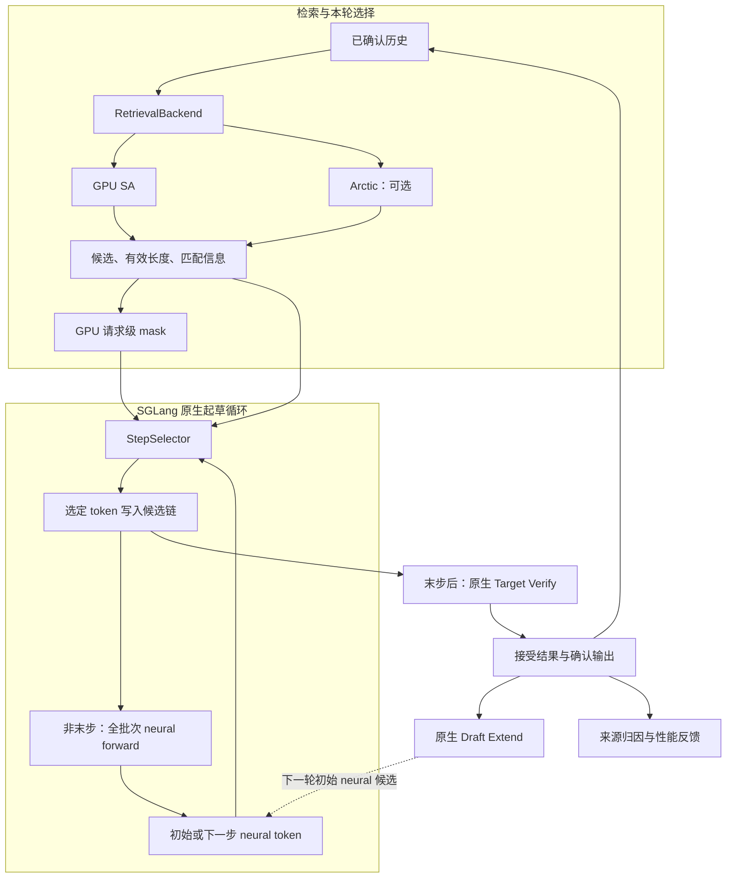

# SGLang 请求级 SA 混合投机设计

> 状态：参考设计；首版实验代码已在本目录实现，实际范围、使用方法和限制见 [README.md](README.md)，验证证据见 [VALIDATION.md](VALIDATION.md)。本文保留完整规划，后续阶段的接口和能力不代表已经实现。
>
> 代码基线：SGLang `a12814c1585b0c954234f776bba93dbdd04b1151`，设计分支 `codex/hybrid-suffix-speculation`。
>
> SA 参考：Baseten `sa_spec` 的 `1cc7e8c86b1914a9c05eb60fb11ebe52daf47969`；TensorRT-LLM SA/MTP 合入快照 `e99d74f1da60be174a4e34b412c4891460b9ff70`。这两个版本用于设计溯源，不表示兼容任意后续版本。

> 2026-10-17：Arctic 官方 CPU 单链后端已接入 full/split；当前实现的调度要求和验证范围见 [Arctic 接入](validation/arctic-suffix.md)。本文其余规划不作为已实现能力清单。

## 目录

- [1. 目标与首版边界](#scope)
- [2. 整体架构与执行流程](#architecture)
- [3. 接口与数据语义](#contracts)
- [4. SGLang 逐步覆盖接入点](#integration)
- [5. CUDA Graph 与资源管理](#graphs)
- [6. 历史、请求生命周期与反馈](#lifecycle)
- [7. 插件交付与目录](#delivery)
- [8. 分阶段实施与验收](#phases)
- [9. 后续动态能力](#future)
- [10. 源码与参考](#references)

<a id="scope"></a>

## 1. 目标与首版边界

在 SGLang 原生投机起草流程中，加入基于历史匹配的候选来源。GPU SA 是主要检索后端，Arctic Suffix 是可选后端。目标是通过改善候选接受长度，减少生成同样输出所需的 target 验证轮数。

首版采用请求级候选覆盖：同一批请求全部正常执行 neural 起草，每个请求根据本轮检索结果，在所有草稿位置使用统一的来源选择。选择在 GPU 上完成，主机不必读取匹配结果，也不必拆分请求批次。

例如，三个请求的设备端选择为 `[SA, neural, SA]`，则三个请求均参与 neural forward，第一个和第三个请求在每个草稿位置使用 SA token。被选择的 token 同时写入最终候选链，并作为后续 neural 起草的输入。

核心约束：

- 首版为 NVIDIA CUDA、单机 TP≥1、纯文本、固定候选长度、`topk=1`、greedy。多 TP 使用各 rank 独立 SA 与起草前候选/选择共识；真实多 GPU 验收状态见 `VALIDATION.md`。
- 每个服务实例先选择一种 neural 后端：普通 EAGLE worker 路径上的 MTP、EAGLE3 或 Standalone；分别完成验证后声明支持。
- 多层 EAGLE、`FROZEN_KV_MTP` 是独立路径，不从普通 MTP 推导兼容性。
- 首版使用固定单链布局，要求候选数 `K = speculative_num_steps`，验证宽度 `K + 1 = speculative_num_draft_tokens`。
- `K` 不包含 anchor；`K >= 1`。起草为零步的模式若以后开放，应整轮禁用覆盖。
- 本轮 mask 固定；检索有效候选不足 `K` 时整条使用 neural，不中途改变来源。
- 保留原生验证、采样及 draft_extend；保留原生 KV 计划和分配流程。
- 随机采样、grammar、混合 prefill/decode、TP/DP/PP、复杂模型状态等需单独验证后开放，不能因底层原生支持就默认插件支持。
- 首版不跳过 neural forward。请求分组、减少起草计算与动态验证长度是后续阶段。

SA 指后缀自动机（Suffix Automaton），Arctic 后端使用后缀树（Suffix Tree）。共同接口描述历史检索能力，不把二者等同于固定长度 n-gram。

### 1.1 设计决策

| 问题 | 决定 | 原因 |
| --- | --- | --- |
| 选择粒度 | 每请求、每轮一次来源选择 | GPU mask 可直接驱动逐步覆盖 |
| 覆盖位置 | 起草循环中逐步覆盖 | 后续 neural 起草沿选定前缀推进 |
| 执行批次 | 全批次正常起草 | 复用固定形状，首版无需子批压缩与主机路由同步 |
| SA 长度不足 | 整条 neural fallback | 不读取无效候选，不引入中途切换语义 |
| 验证路径 | 构造原生单链输入并复用验证 | 来源选择不改变固定链拓扑 |
| Graph 管理 | SGLang 适配层持有 | 策略层不操作模型 graph runner 或 KV |
| 扩展方式 | 独立包 + 少量显式接口补丁 | 避免复制整段 worker 和长期维护大块替换 |

<a id="architecture"></a>

## 2. 整体架构与执行流程



### 2.1 每轮流程

1. 在 worker 已解析本轮 speculative 输入、请求顺序稳定之后，取得当前请求标识与历史版本。
2. 确保检索历史消费了上一份确认增量，包括当前 anchor；首次 decode 包括 prefill 产生的首个输出 token。
3. 查询 `K` 个候选；在 GPU 计算本轮 `use_retrieval`。准备过程放在 neural draft Graph 外。
4. 起草第 0 个位置：读取 prefill 或上一轮 draft_extend 保存的 neural 候选，映射到 target token 空间后执行选择。
5. 后续位置：用上一个选定 token 执行 neural forward，得到 neural token，完成映射后执行选择。
6. 选定 token 同时更新下一步输入和最终候选链。普通单链下，`K` 个候选消费一个已有 seed，并执行 `K-1` 次循环内 forward。
7. 原生构建函数添加一次 anchor，生成固定宽度验证输入，运行 target 验证。
8. 保留原生 draft_extend；将确认结果归一化为历史增量，供下一轮更新；记录来源和接受情况。

首版匹配策略是配置化阈值规则，不在本文预设经验默认值：后端状态正常、历史版本匹配、匹配长度达到阈值、有效候选不少于 `K`，并满足当前能力约束时才启用检索。

候选选择不是两个独立完整草稿的事后拼接。被覆盖后的 token 会影响后续 neural 计算；首版即使没有减少 neural forward，也必须保持这条递推关系。

### 2.2 模块责任

| 模块 | 输入与输出 | 所有权 |
| --- | --- | --- |
| `HybridRuntime` | 组织历史、查询、本轮选择与反馈 | 每个 spec worker 一个实例 |
| `RetrievalBackend` | 历史增量 → 检索候选 | 后端持有索引和请求槽位，不持有 SGLang KV |
| `SelectionPolicy` | 候选元数据与固定预算 → 设备端 mask | 不调度模型执行，不读取逐请求 GPU 结果到 CPU |
| `StepSelector` | neural token、检索 token、mask → 选定 token | 可捕获的张量操作；以后可融合 kernel |
| `SGLangAdapter` | SGLang 类型 ↔ 通用契约 | 持有 graph buffer、事件及本轮资源引用 |
| `Metrics` | 来源、接受结果、耗时与资源 | 聚合统计，不在热路径强制同步 |

Core 不导入 SGLang 类型，可以表达设备张量和异步就绪事件。Graph 和 KV 适配集中在 integration 层。

<a id="contracts"></a>

## 3. 接口与数据语义

以下字段和方法是设计契约，不是可直接调用的现有 API。

### 3.1 数据结构

| 对象 | 必要字段 | 语义 |
| --- | --- | --- |
| `RequestKey` | `rid`, `generation` | 同一请求 ID 再利用时仍可区分旧异步结果 |
| `RequestSnapshot` | 请求键、请求顺序、历史版本、槽位、剩余输出预算 | 本轮查询的稳定视图 |
| `HistoryDelta` | 请求键、起止版本、`accept_tokens`、`num_accept_tokens`、offsets 或输入 stride、就绪事件 | 追加的确认输出；相同增量只消费一次 |
| `RetrievalCandidates` | `tokens[B,K]`、`num_valid_drafts[B]`、`match_lens[B]`、状态、历史版本、就绪事件 | 区分历史匹配长度与实际可用续写长度 |
| `DraftOverrideView` | `tokens[B,K]`、`use_retrieval[B]`、有效行信息、`K`、资源引用 | 本轮起草使用的设备视图 |
| `HybridStepFeedback` | 请求键、本轮来源、`num_correct_drafts`、`num_accept_tokens`、结束/截断信息、阶段耗时 | 按本轮计划进行来源归因 |
| `BufferLease` | buffer 引用、最后使用事件 | 在全部消费者结束前禁止覆盖、释放或复用 |

词汇与长度约定：

- 所有检索候选和选定 token 都使用 target tokenizer 的 token 空间。
- anchor 是已确认的上下文末 token；检索候选不含 anchor，验证构建器添加一次。
- `accept_tokens` / `num_accept_tokens` 包含 bonus；`correct_drafts` / `num_correct_drafts` 不包含 bonus。
- `match_lens` 表示匹配了多长历史，不能代替 `num_valid_drafts`。
- 检索分数只供选择策略使用，不等于随机采样所需的 proposal distribution。
- mask 必须按明确的行维度广播，例如适配 `[B,1]` 的 neural token；不得意外广播成 `[B,B]`。

### 3.2 检索后端

| 方法 | 调用方 | 必要输入 | 结果与失败处理 |
| --- | --- | --- | --- |
| `capabilities()` | 初始化 | 无 | CPU/GPU、异步、候选形态、历史范围等能力 |
| `estimate_memory(config)` | 启动资源规划 | 容量与设备配置 | 内存估计；在 KV 池占满之前纳入预算 |
| `open_request(key, history)` | 生命周期适配 | 初始历史、版本 | 建立槽位；不足时明确拒绝或 neural fallback |
| `update(delta)` | 历史适配 | 确认增量 | 版本/偏移校验，保证恰好追加一次 |
| `query_into(snapshot, budget, outputs)` | 起草准备 | 当前请求顺序、固定 `K`、输出空间 | 写候选和有效长度，返回就绪依赖 |
| `suspend/resume` | 重算与恢复适配 | 请求键、确认历史 | 保留状态或按版本重建 |
| `close_request(key, reason)` | 结束适配 | 结束原因 | 等待相关事件后回收槽位 |
| `reset(scope)` | flush/reset 适配 | 清理范围 | 明确区分活动请求状态与可选共享缓存 |

GPU SA 移植需拆开 accepted 输入 stride 与候选输出宽度，返回有效长度和状态，并防止 padding 行更新真实自动机。原始 `sa_spec` 的全局、编译期容量管理应改成显式实例资源。底层可以融合更新和查询，但不能模糊更新次数。

Arctic 输出同一候选契约，首版只使用单链模式。其 CPU 查询和 H2D staging 在 Graph 外完成；如果本轮未就绪，整轮 neural fallback，并在下次复用输出空间前处理完成事件。不能直接把 Arctic 的多分支候选或频次分数用于当前单链采样。

### 3.3 逐步选择与 Graph 绑定

| 接口 | 责任 |
| --- | --- |
| `prepare_override(snapshot, K)` | 在本轮输入已解析后查询后端，计算 mask，形成临时视图 |
| `select_step(neural_tokens, view, step, output)` | GPU 上选择本位置 token；不得读 CPU 结果或更新请求历史 |
| `stage_graph_inputs(view, graph_buffers, raw_bs, padded_bs)` | 将本轮数据写入固定地址，清除 padding mask |
| `bind_capture_view(graph_buffers, capture_bs)` | 为捕获使用的 ForwardBatch 绑定静态视图 |
| `on_verify_result(result, step_context)` | 按真实接受布局提取增量，记录来源并维护资源依赖 |

`step` 是循环位置（0 到 `K-1`），捕获时随固定循环展开。禁止依赖跨 replay 自增的 Python 字段。本轮候选在运行前按实际请求顺序重建，不作为跨轮 FutureMap 的持久状态。

<a id="integration"></a>

## 4. SGLang 逐步覆盖接入点

### 4.1 当前已核实的行为

- `EAGLEWorkerV2.forward_batch_generation()` 组织 draft、verify、draft_extend。
- `EagleDraftWorker.draft()` 选择 eager 或 draft graph，随后调用 `build_eagle_verify_input()`。
- `draft_forward()` 的首个候选来自 `EagleDraftInput.topk_index`；后续候选来自循环内模型输出。
- 首候选和后续候选均可能经过 `hot_token_id` 映射。
- CUDA topk=1 快速路径直接构造 `draft_tokens_topk1`；后处理算子会提前写入下一候选列。
- Standalone 继承相同的 draft 方法，但构造函数有自己的初始化逻辑。
- Graph runner 在捕获时调用 `draft_forward()`，replay 时不重新执行这段 Python。

### 4.2 起草前准备

在 worker 已解析本轮 speculative 输入之后、`draft()` 的 eager/graph 分支之前准备 override。第一阶段不支持混合 prefill/decode 和 PP 预构造验证链等分支；能力校验必须阻止它们误入普通路径。

将临时 view 传给本轮 ForwardBatch。若选择在 `EagleDraftInput` 增加可选字段，必须约定只在实际执行前绑定、执行完成后清理；捕获用输入由 graph runner 显式绑定。不能假设给普通 batch 动态挂属性就会自动出现在捕获用 batch 中。

### 4.3 首个候选

在 `draft_forward()` 读取初始 `topk_index`，完成 `hot_token_id` 映射后，选择第 0 个候选。位置必须早于：

1. `draft_tokens_topk1[:, :1]` 的首次写入。
2. 第一次 `select_top_k_tokens()` 或生成 `input_ids`。

不改写 `bonus_tokens`。prefill 与 draft_extend 继续产生正常 neural seed，再由本轮起草统一覆盖。`K=1` 时也必须经过此入口，即使没有独立 neural draft Graph。

### 4.4 后续候选

循环内顺序为：neural forward → 原生 argmax/后处理 → neural 输出词表检查 → hot-token 映射 → 第 `i+1` 个候选覆盖 → 后续消费。

SA token 注入后，不再用 draft 输出词表大小检查，也不再做一次 hot-token 映射。后端输出应在准备阶段保证 target token 合法；调试模式可增加独立检查。

greedy、topk=1 下沿用单链拓扑；禁止把未匹配的 neural proposal 概率当成覆盖后候选的分布。扩大到随机采样前必须重新设计 proposal 语义。

### 4.5 快速候选矩阵写入

必须满足不变量：每个位置写入最终验证链的 token，等于该位置被选择并交给下一次 neural forward 的 token（末位置没有后续 forward）。

首版保留 `draft_topk1_postprocess()`，选择后覆盖相应的候选矩阵列；普通 token-list 分支则在追加 token 前完成选择。这样 eager 与 Graph、矩阵与列表路径共享相同语义。

不能只覆盖 `topk_index`，否则快速矩阵中可能残留 neural token；也不能只覆盖最终矩阵，否则 neural 状态沿另一条前缀推进。后续再评估将 argmax、来源选择、矩阵写入融合为一个 kernel。

### 4.6 预期补丁范围

| 文件/区域 | 拟改动 | 阶段 |
| --- | --- | --- |
| `speculative/eagle_worker_v2.py` | 本轮准备、首候选与后续候选选择入口、结果通知 | 首版 |
| `speculative/eagle_draft_cuda_graph_runner.py` | buffer 分配、捕获绑定、replay staging、padding 清理 | Graph 接入 |
| `speculative/eagle_info.py` | 临时 view 的承载接口（如采用此方案） | 首版 |
| `speculative/standalone_worker_v2.py` | 装配相同扩展实例；避免只改父类构造函数 | Standalone 接入 |
| `speculative/base_spec_worker.py` 及结果/调度路径 | 补齐结束、撤销、恢复、reset 的通知 | 生命周期完善 |
| `kernels/ops/speculative/topk1.py` | 融合覆盖和候选写入 | 测量后优化 |
| `speculative/eagle_worker_common.py` | 复用验证构建和执行；必要时补窄结果通知 | 不复制验证逻辑 |

attention 和验证采样 kernel 首版复用。配置保持原生 `EAGLE` / `EAGLE3` / `STANDALONE` 身份，避免新算法名绕过现有模型与配置分支。

<a id="graphs"></a>

## 5. CUDA Graph 与资源管理

### 5.1 三段模型 Graph

当前 neural draft、target verify、draft_extend 分别有执行/捕获路径。target forward 返回后的采样和接受处理不能整体视作已捕获的 verify Graph。

首版只将逐步选择纳入 neural draft Graph。检索历史更新、查询及候选 staging 在其外部执行。目标验证和 draft_extend 保持原生 Graph 形状。

来源 mask 从全 false 变为全 true 或混合值，属于输入数据变化，不创建来源组合 graph。首版不按 SA 请求数重新划分模型 batch。

### 5.2 静态输入

在 graph runner 捕获前建立扩展 buffer，至少包含 `retrieval_tokens[B_max,K]` 和 `use_retrieval[B_max]`。有效行可使用单独 mask，也可折入 `use_retrieval`。类型和步长与当前候选路径明确对齐。

| 时点 | 操作 |
| --- | --- |
| runner 初始化 | 分配持久 buffer，确定最大 batch 与固定 `K` |
| `capture_one_shape()` | 切出捕获 batch 桶的静态 view，绑定到捕获用输入 |
| 每次 `execute()` | 写入实际请求行；清除 padding 区域的来源 mask；等待候选就绪 |
| replay | 每步读取相同地址的候选和 mask，执行选择 |
| 结果消费完毕 | 根据完成事件允许复用 buffer |

替换 Python tensor 引用不能更新已捕获的设备地址，必须写入捕获使用的存储。不得在 replay 中扩容 SA workspace 或替换已绑定 buffer。

捕获时即使所有请求都未命中，也必须记录选择操作；不能通过 `mask.any().item()` 或其他 Python 分支跳过。插件关闭时可保留原生路径；启用插件后捕获的扩展路径必须允许运行时 mask 改变。

### 5.3 可变数据与有副作用状态

SA kernel 内部可以依据设备数据执行不同次数的遍历，但其调用和存储管理需要满足捕获条件。将来若捕获 SA，需要固定 workspace、请求映射、输出空间，以及无效行保护。

SA 更新具有副作用。warmup、autotune 和 capture 不得重复向真实请求追加历史。首版将历史更新留在模型 Graph 外；将来使用独立 SA Graph 时，应使用测试槽位或明确恢复状态，并验证每份增量只更新一次。

### 5.4 Stream 与 overlap

首版优先按当前 forward stream 建立顺序依赖，独立开启 overlap 前验证资源生命周期：

1. SA 更新读取确认输出前等待其就绪。
2. staging 和 draft replay 等待候选及 mask 就绪。
3. 查询输出、Graph 输入及接受结果在最后消费者完成前保持引用。
4. 若新增 side stream 消费原生共享 buffer，需补充其 read-done 事件；不能认为现有 draft_extend 结束事件自然覆盖新增消费者。
5. 同一组可写静态 buffer 不支持未经隔离的并发 replay。需要并发时分配独立资源槽，并维持对应的 lease。

SA 状态显存应在目标 KV 池预算确定前纳入规划。容量耗尽采用显式 neural fallback，不静默截断 batch。高层可预期失败与 GPU 执行错误分开处理，不能吞掉异步 kernel 错误继续服务。

<a id="lifecycle"></a>

## 6. 历史、请求生命周期与反馈

| 事件 | 必要动作 |
| --- | --- |
| 新请求 | 建立 RequestKey 和槽位，记录真实 token 历史；不索引 padding/多模态占位数据 |
| chunk prefill | 按历史偏移处理，不重复追加整段 prompt；首版先限制复杂路径 |
| 首次生成 | 将实际首个输出 token 作为下一轮历史末端/anchor |
| 每次验证 | 按接受索引与数量整理实际 token，生成带版本增量 |
| 退出当前 batch | 不推断请求结束 |
| retract/恢复 | 保留可校验状态，或依据确认历史重建；不能沿用失配版本 |
| EOS/长度停止/abort | 最终确认内容与结束原因传给后端，按完成事件释放 |
| flush/权重或上下文重置 | 按明确 scope 清理；失效旧 lease 和历史映射 |

验证返回的 `next_token_ids` 不能直接假设为连续 `[B,K]`，适配器必须结合实际 `accept_index`、`accept_lens` 及输出 stride 归一化。输入增量 stride 与下一轮候选宽度独立。

设备端已验证进度与 CPU 最终输出提交分开记录。EOS、停止条件、grammar 等可能截断结果；首版通过能力限制减少复杂性，后续仍需 reconcile。特别是 Arctic 跨请求缓存只能保留最终有效输出；请求内 GPU SA 若已经追加终止后的尾部，应在结束时丢弃，恢复/复用前必须重建或校正，不能无条件把设备进度当最终历史。

原生 `on_verify_complete_cpu()` 只有接受数量，不能独立完成来源归因。插件应使用本轮上下文关联请求键、来源 mask 和有效预算，并利用已有 CPU 结果回传路径异步归集统计。

至少记录：检索查询与更新、候选 staging、选择开销、neural draft、target verify、draft_extend、接受长度、SA 选中率、fallback 原因、额外显存、TPOT 与吞吐。首版不声称减少 neural forward；净收益应包含所有新增开销。

<a id="delivery"></a>

## 7. 插件交付与目录

最终交付为独立 `hybrid-spec` Python 包、可选 CUDA/C++ 扩展和少量 SGLang 接口补丁。以下目录是规划，不由本设计稿创建实现骨架。

```text
hybrid-spec/
├── pyproject.toml
├── src/hybrid_spec/
│   ├── plugin.py
│   ├── config.py
│   ├── core/
│   │   ├── contracts.py
│   │   ├── runtime.py
│   │   ├── request_state.py
│   │   └── capabilities.py
│   ├── backends/
│   │   ├── gpu_sa/
│   │   └── arctic/
│   ├── selection/
│   │   ├── policy.py
│   │   └── step_selector.py
│   ├── integrations/sglang/
│   │   ├── registration.py
│   │   ├── draft_extension.py
│   │   ├── graph_buffers.py
│   │   ├── history_bridge.py
│   │   ├── lifecycle.py
│   │   └── compatibility.py
│   └── observability/
├── csrc/gpu_sa/
├── configs/
├── compat/sglang/
├── third_party/
├── tests/
└── benchmarks/
```

复用现有 `sglang.srt.plugins` entry point 和启动装配机制。注册阶段不创建 CUDA 上下文、不分配设备资源；worker 装配时创建实例。HookRegistry 可用于装配扩展，逐步 token 选择使用窄接口，不替换整段 worker。

配置由插件解析为不可变实例配置，暂不承诺任何新 CLI 或环境变量。内容包括后端、固定 `K`、匹配阈值、SA 容量、fallback、统计和能力限制。若后续加入 SGLang 配置字段，遵守 runtime-context 的声明与解析机制；不在热路径改写 ServerArgs。

`compat/sglang/` 记录支持提交、补丁与接口校验。启动检查起草 hook、Graph buffer 绑定和模型能力，不兼容时明确报错。保留第三方来源、固定版本与许可证；研究用的本地 sa_spec checkout 不作为运行依赖，也不依赖完整 TensorRT-LLM。

<a id="phases"></a>

## 8. 分阶段实施与验收

| 阶段 | 交付内容 | 验收门槛 |
| --- | --- | --- |
| P0：契约与基线 | 锁定版本、支持矩阵、扩展接口和纯 neural 基线 | 关闭插件可保留原生行为；初始化阶段明确拒绝未支持配置 |
| P1：SA 与 eager | GPU SA 实例资源、历史版本、有效长度、逐步选择；先一种 neural 路径 | 与简单序列匹配 oracle 对照；每步输入与最终候选一致；无重复追加 |
| P2：CUDA Graph | 静态 buffer、捕获绑定、staging、padding、K=1 路径 | 同一 Graph 在全 SA、全 neural、混合 mask 间切换正确；无逐请求主机同步 |
| P3：生命周期与模型扩展 | 结束、重算恢复、reset、overlap；分别覆盖 MTP/EAGLE3/Standalone | 请求重排、槽位复用、连续执行无污染；设备资源生命周期正确 |
| P4：可选后端与优化 | Arctic 单链、统计、必要的算子融合；并行能力按项开放 | 不同后端共享契约；测量完整循环净收益和同步成本 |
| P5：动态与减少起草计算 | 预算分桶、逐请求变长、跳过部分 neural 起草 | 独立验证采样、KV、Graph 和状态追赶；不与首版捆绑 |

必要的行为验证：

- `K=1`、首候选和末候选覆盖，避免偏移一位。
- 全命中、全未命中、混合来源、有效长度不足、容量不足。
- 初始 hot-token 映射、后续映射；SA token 不重复映射。
- topk=1 快速矩阵与普通列表路径，保证递推输入和验证链一致。
- Graph 捕获时全 false、replay 时全 true；反向切换及 padding 行清理。
- 请求顺序变化、新增/结束/撤销、历史恢复、ID 和槽位再利用。
- Graph 开关两种路径的候选选择语义一致；确定性测试配置下与 target greedy 输出比较，数值差异需定位，不能直接归因于选择策略。
- 用设备时间线验证新增同步和 buffer 依赖；正常性能路径不靠每步 `.item()`、`.cpu()` 或全设备 synchronize 完成选择。

测试覆盖接口语义、状态一致性和实际行为，不复制实现细节。实施时按仓库测试规范落位。性能报告必须说明模型、硬件、长度、并发、Graph/overlap 配置，不能将外部实现的收益当作本项目结果。

<a id="future"></a>

## 9. 后续动态能力

后续需要独立表达 `draft_budget`、实际有效候选数、`verify_budget`、执行桶和容量。匹配长不等于可用续写长；逻辑裁剪不等于减少物理计算。

推荐顺序：固定来源选择 → 批级有限长度桶 → 草稿与验证预算解耦 → 逐请求 ragged 验证 → 减少 neural 起草。当前 adaptive 仅覆盖部分 EAGLE/EAGLE3 配置，Standalone 没有接入现有 controller；当前算法能力声明只对 DSpark 开放 ragged verify。不能仅翻转 capability 就假定 EAGLE 混合已支持。

动态控制由一个控制器统一决策，复用并扩展运行资源状态。预构建状态必须同时覆盖 draft、verify 和 draft_extend 的形状；前一轮资源仍被使用时不能任意切换共享状态。

若希望依据本轮 GPU 匹配结果立即选择主机侧 Graph 桶，需要承担同步或另行设计设备端调度；也可利用已有反馈决定后续轮次预算。首版固定形状规避了这一依赖。

减少起草计算时，设备端 `torch.where` 本身不会减少全批次模型 forward。需另行设计子批 gather/scatter、batch 桶选择、KV 计划和恢复策略；即使跳过 draft，也必须考虑 neural hidden state 与 KV 的追赶。候选选择契约可以保留，执行策略再扩展。

<a id="references"></a>

## 10. 源码与参考

以下本地链接相对本文件，符号与行号按顶部固定提交核实；后续源码变更时应同时更新设计基线。

| 文件与符号 | 当前行为/设计关联 |
| --- | --- |
| [eagle_worker_v2.py](../../python/sglang/srt/speculative/eagle_worker_v2.py) — `draft`（614）、`draft_forward`（696） | eager/graph 分支、首候选、逐步递推、快速矩阵 |
| 同文件 — `_draft_extend_for_prefill`（910）、`_draft_extend_for_decode`（1054） | 初始 neural seed 与验证后的状态同步 |
| 同文件 — `forward_batch_generation`（1350）、`verify`（1907） | 一轮执行与验证边界 |
| [eagle_draft_cuda_graph_runner.py](../../python/sglang/srt/speculative/eagle_draft_cuda_graph_runner.py) — `EagleDraftInputBuffers`（66）、`capture_one_shape`（371）、`execute`（553） | 静态输入、捕获用 batch、replay staging |
| [eagle_info.py](../../python/sglang/srt/speculative/eagle_info.py) — `EagleDraftInput`、`EagleVerifyInput` | 初始候选、跨轮输入和验证数据语义 |
| [topk1.py](../../python/sglang/kernels/ops/speculative/topk1.py) — `draft_topk1_postprocess`（74） | argmax 后处理与候选矩阵写入 |
| [eagle_worker_common.py](../../python/sglang/srt/speculative/eagle_worker_common.py) — `build_eagle_verify_input`（395）、`run_eagle_verify`（565） | 原生链构建、验证与接受结果 |
| [standalone_worker_v2.py](../../python/sglang/srt/speculative/standalone_worker_v2.py) — `StandaloneDraftWorker`（31）、`StandaloneWorkerV2`（125） | 共享起草方法与独立初始化 |
| [base_spec_worker.py](../../python/sglang/srt/speculative/base_spec_worker.py) — `on_verify_complete_cpu`（342）、`note_request_finished`（352） | 现有反馈与结束通知 |
| [batch_result_processor.py](../../python/sglang/srt/managers/scheduler_components/batch_result_processor.py) | CPU 接受结果、最终提交及结束通知 |
| [plugins](../../python/sglang/srt/plugins/__init__.py)、[hook_registry.py](../../python/sglang/srt/plugins/hook_registry.py) | 现有插件发现和装配机制 |
| [adaptive_runtime_state.py](../../python/sglang/srt/speculative/adaptive_runtime_state.py)、[adaptive_spec_params.py](../../python/sglang/srt/speculative/adaptive_spec_params.py)、[ragged_verify.py](../../python/sglang/srt/speculative/ragged_verify.py)、[spec_info.py](../../python/sglang/srt/speculative/spec_info.py) | 后续动态预算的已有资源组织与能力边界 |

外部参考：

- [Baseten sa_spec 固定快照](https://github.com/basetenlabs/sa_spec/tree/1cc7e8c86b1914a9c05eb60fb11ebe52daf47969)：原始 GPU SA 算法、接口和容量管理参考。
- [TensorRT-LLM #11434](https://github.com/NVIDIA/TensorRT-LLM/pull/11434)：已合并 SA 集成；不依赖仅关闭未合并的早期 PR。
- [合入快照中的 mtp.py](https://github.com/NVIDIA/TensorRT-LLM/blob/e99d74f1da60be174a4e34b412c4891460b9ff70/tensorrt_llm/_torch/speculative/mtp.py)：确认输出后更新 SA，并在 `draft_sampler` 每步通过 `torch.where` 选择 token。不是只在整条链完成后替换。
- [Arctic Suffix 缓存固定快照](https://github.com/snowflakedb/ArcticInference/blob/aca5d9a8a62474035c15d114d40a01abc8c94b51/arctic_inference/suffix_decoding/cache.py)：可选 CPU 后端、请求内历史与跨请求缓存语义参考。

## 快速回忆

全批次正常起草；本轮每请求一个 GPU mask；从首候选到末候选逐步覆盖；选定 token 同时驱动后续 neural 输入和最终验证链；Graph 使用固定地址输入；历史只消费确认增量；首版改善接受长度，后续再减少 neural 起草计算。
