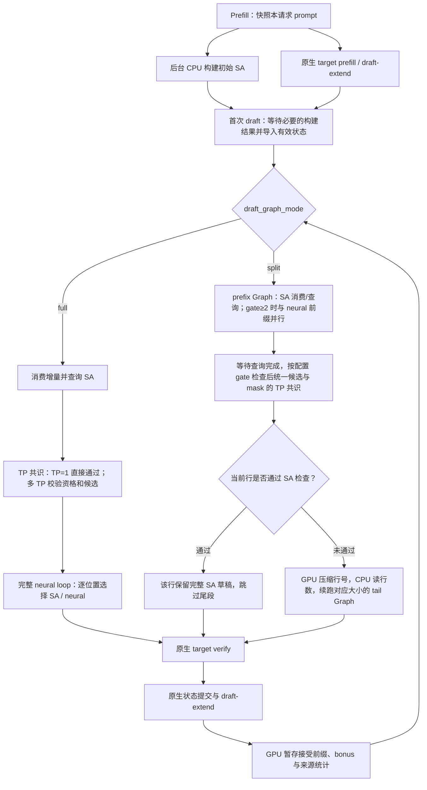

# Hybrid Spec 优化总览

> 记录日期：2026-10-16。源码依据：`codex/hybrid-suffix-speculation` 分支截至
> `972aa160983b42cae3cadd5662b8d4f3d4aa7b03`。本页汇总当前实现与已有实测，
> 不代表新增了一轮性能或正确性验收。
>
> 2026-10-17 增补：本分支新增默认关闭的跨请求全局池，详见
> [全局池实现与验证](validation/global-pool.md)。下列 C1/C4 性能记录均来自未开启全局池的旧实验。
>
> 2026-10-17 再增补：split 已接入 SA 查询与首个 MTP forward 的 stream 重叠、
> 预分配尾段行号和单机多 TP 统一决策。以下更新机制描述，GPU 性能与多卡模型
> 仍待内网验收；本地检查及复现命令见 [验证记录](VALIDATION.md)。
> 同日修复 DeepSeek V4 SA 的 SWA 校验和 split 架构拦截，并将 V4 接入逐请求
> 紧凑尾段：混合批只执行未命中行，注意力及 per-step KV 元数据仍使用原生 dsv4。
> 模型 GPU 验收待完成；下文历史吞吐不能作为此次改动的性能结果。
>
> 2026-10-17 动态调度更新：移除 batch≤4 硬限制，GPU 生成稳定行号，CPU 只读
> 行数；gate 支持 0…K，split API 升到 v4。4060 功能回归与边界见
> [动态行号与 gate](validation/dynamic-rows-gate-20261017.md)，不新增模型吞吐结论。
>
> 同日三算法接入：EAGLE3 和 STANDALONE 也使用相同 split 调度，补充词表映射、
> 空 recurrent hidden state 和 native Triton KV 索引回归；当前 split API 为 v5。
> [4060 验证及边界](validation/draft-algorithms-split-20261017.md)。

Arctic 可选后端现已接入 full/split/split_no_skip，使用官方 CPU 后缀树和
GPU 接受路径补齐请求私有历史、CPU 已确认输出构建共享树，共用 GPU gate/TP/紧凑调度；
现已允许 overlap 与 chunked prefill，需要接受路径 D2H 和下次查询消费等待。
安装和边界见 [Arctic 接入](validation/arctic-suffix.md)，不新增模型性能结论。

## 目录

- [1. 当前定位与结论](#1-当前定位与结论)
- [2. 请求运行流程](#2-请求运行流程)
- [3. 已完成的优化](#3-已完成的优化)
- [4. A100 性能与正确性记录](#4-a100-性能与正确性记录)
- [5. 配置、版本与部署](#5-配置版本与部署)
- [6. 支持边界与后续方向](#6-支持边界与后续方向)
- [7. 证据与代码入口](#7-证据与代码入口)

## 1. 当前定位与结论

插件在 SGLang 原生投机解码中增加后缀自动机（SA）草稿来源：从请求自身历史中
寻找重复后缀，将历史续写作为候选，最终仍由原生 target verify 验证。
当前主实验是 Qwen3.5-35B-A3B-GPTQ-Int4 的原生 MTP，SGLang 算法身份为 `EAGLE`。

当前支持完整运行 MTP 与按请求压缩尾段。默认 `draft_graph_mode="full"`，仍执行
完整 neural draft。显式开启 `split` 后，按配置 gate 检查并省掉命中行的后续
MTP forward；不再以 4 限制 batch，G=K 时没有可省略的尾段。

截至目前的结论：

- 设备历史、CPU 初始构建与 prefill 重叠、反馈统计融合和高分叉哈希均已接入。
- SA v3 将历史状态预算降至约 68 字节/token，并缓解低多样性历史的追加退化。
- C1 两段 Graph 在该轮 A100 edits 实验中，相对原生吞吐约 +12.2%、TPOT 约 −10.6%。
- C4 已实现真正的按行裁剪，但本轮相对完整 MTP+SA 吞吐 −2.44%、TPOT +2.68%，没有额外收益。
- 默认仍各查本请求；开启 `enable_global_pool` 后可跨活跃槽位查询，并按容量保留完成请求。

CPU 微基准、CUDA 功能测试、profiler 时间和官方服务性能分别记录，不互相替代。

## 2. 请求运行流程

下图的逐行 split 分支适用于 EAGLE/MTP、EAGLE3 和 STANDALONE；共用紧凑调度，保留
Triton 与原生 dsv4 注意力。V4 每个尾段批单独规划请求行和逐步 KV 写入地址。



`split_no_skip` 用作控制模式：保留拆图与 CPU 行数读取，让所有实际行执行尚余尾段，
仍按相同策略选择 SA 候选。它不会关闭 SA。

### 历史与生命周期

每个请求分配独立 slot，保存历史、SA 状态、转移边和 generation。默认请求结束释放 slot，
新请求复用时初始化新代际；旧反馈和旧后台构建结果不能写入新代际。
flush、retract、请求重排和 Graph padding 都必须保持这一映射。

开启可选全局池后，已导入的活跃 slot 之间可以互查；完成请求按 `max_shared_requests`
上限保留，按完成顺序 FIFO 淘汰。保留来源的最终反馈按 CPU 确认的停止边界截断；
已索引的丢弃尾部会使该来源失效。flush 也清除保留来源。各请求始终保持独立文本边界。

历史包括本请求的 prompt 和用于起草的已接受前缀。device 模式的 GPU 反馈可能包含
CPU EOS/停止条件截断前的尾部，因此索引长度不能直接当成交付 token 数。
历史超容量时回退 neural；当前没有自动滑动窗口淘汰。

默认配置下，请求 A 生成过某段代码，请求 B 不会检索 A 的 SA。若这段代码本来就包含在
B 的 prompt 中，B 可以从自身历史匹配。提高 `max_requests` 仅增加可维护的请求槽位，
不会开启跨请求检索；必须显式开启 `enable_global_pool`。

## 3. 已完成的优化

### 3.1 设备增量历史与 prefill 重叠

旧 CPU 历史路径依赖主机端已提交输出。device 路径直接使用 verify 的 GPU 接受结果，
下一轮在 draft Graph 内消费增量并查询，避免每轮读取或重新比对完整 CPU 输出历史。

初始 prompt SA 改为后台 CPU 原生 C++ 构建，调用释放 GIL，可与 target prefill 和
draft-extend 重叠。只导入已使用的状态前缀，pinned 源缓冲保留到 H2D 事件完成。
构建尚未完成时首次 draft 仍需等待，不能称为完全隐藏了构建成本。

已接入 chunked prefill 的最后分块快照与反馈处理；现有短 edits 输入未实际跨越
A100 实验的 chunk size，不能将“开启该参数”当成长 prompt 多分块验收。

### 3.2 TP 共识、反馈统计与固定映射

full 的多 TP 候选共识放在 draft `prepare()` 中，紧跟 SA 查询；split 则在
配置宽度的 gate 就绪、查询汇合后执行，可被 CUDA Graph 捕获。
一次精确 MIN 归约携带候选、按位取反的候选及资格：只有所有 rank 均合格且 token
一致，才使用 SA。不能因某个 rank 本地未命中就跳过 collective；TP=1 不执行该通信。
这一机制已接通，多 GPU 模型与真实 NCCL Graph 时间线仍需单独验收。

六项来源统计融合进已有 verify 反馈 kernel，减少单独归约和逐元素算子。
当请求顺序、代际及捕获形状均不变时复用 slot/generation 映射，避免重复 staging；
SA 查询与必要的 TP 共识仍每轮执行。组件改进不等于已有独立的端到端收益归因。

### 3.3 长历史转移查找、紧凑状态与低多样性优化

高分叉状态的转移查找引入按 `(state, token)` 索引的哈希，增量分桶扩容，
decode 时不整表重建。小出度保留短路径，避免为所有状态支付哈希维护成本。

随后 v3 将第一、第二条转移内联在状态中，第三条转移才使用额外边记录，
总出度超过 4 时建立哈希。单一重复历史走直接延长链的快路径；二值历史的额外边记录
和已用哈希桶数为零，相关数组仍按配置容量预分配。
边池从 `3H+1` 缩到 `H+1`，依据确定性自动机非第一转移的上界，而非语料经验缩容。

| 状态预算口径 | 每历史 token 约占用 |
| --- | ---: |
| 原始链表 | 72 字节 |
| 上一版哈希 | 108 字节 |
| 当前紧凑 v3 | 68 字节 |

该预算不包含所有 Graph pool、暂存输出及主机 pinned 构建内存。
相对上一版哈希减少约 37%；32×16384 的历史状态池约 34 MiB/rank。

CPU 微基准中，256K 二值历史追加相对原始链表约快 1.49×；8K 二值追加持平。
8K 二值初始构建仍由 0.272 ms 增至 0.301 ms，约慢 10.7%，不能说所有阶段都无回退。
CPU 微基准的高分叉加速比不能直接推算 GPU 查询或模型 TPOT。

### 3.4 接受长度回退诊断与 neural 前缀检查

同位置 shadow 诊断发现：短后缀即使重复，其续写也可能与 target 不同，例如缩进或
说明标签差异。4,746 次独立 sa-spec C++ 查询差分一致，没有发现需要修改历史偏移
或 anchor 对齐的证据。有害替换位置的 token 损失不能当作整场实验净损失。

增加可选 `num_neural_gate_tokens=N`：前 N 个位置保持 neural 路径，且要求 SA
候选与之逐个一致；遇到不一致则本轮剩余链均回退 neural。全部通过后才允许 SA
接管后续候选。这是新增的选择策略，默认 0，不宣称原始 sa-spec 采用这一检查。

`min_match_len` 是历史匹配门槛，`num_neural_gate_tokens` 是候选检查长度，
`num_drafts=K` 才是草稿宽度。把最小匹配改为 16，不会把 K=8 的验证宽度改为 17；
验证仍为 8 个草稿加一个 bonus。单独开启前缀检查也不会减少 MTP forward。

### 3.5 C1 两段 Graph：条件取消六次 MTP forward

以 K=8、G=2 为例，第一个 neural 候选已由前一轮 draft-extend 提供。因此 prefix Graph
只需一次 inner forward，就能检查前两个候选；通过则直接使用完整 SA 链，
否则从 prefix hidden state 续跑剩余 6 次 forward，不从头重跑。

当前两段之间由 GPU 动态生成行号，CPU 读取一次行数后条件提交。`decision_wait_ns` 包含尚未完成的
prefix GPU 工作，不能全当成额外同步成本。target verify 和 draft-extend 仍然运行。
各 Graph 保持私有 pool，保护跨图中间状态。

### 3.6 C4 混合批：只给未命中行执行尾段

整批计算 prefix 后，按未命中行数选择 1/2/3/4 行 tail Graph。收集对应请求的
hidden state、第二候选、位置、mRoPE、request pool index 和 KV 写入地址，
重建相应大小的注意力元数据，再将输出写回原行。全命中则不提交尾段。

例如 `[命中, 未命中, 命中, 未命中]` 只将第 2、4 行送入 2 行尾段。
必须使用 runner 的 `raw_bs` 排除临时 padding；不能使用已补齐的 `batch_size`。
capture 外分配的暂存张量须显式持有，避免后续分配复用其地址。

这确实减少了请求行的模型计算，但不保证同比例降低 GPU 时间。当前小 batch
LM head 的主要耗时对 1～4 行变化很小；多数混合批仍要执行六次大权重矩阵计算。

## 4. A100 性能与正确性记录

两组均为同一 A100 PCIe 40GB、Qwen3.5-35B-A3B-GPTQ-Int4、TP=1、K=8，
官方 `sglang.benchmark.serving`、sa-spec 原始 edits completion 模板、输出上限 2048、
temperature=0、保留 EOS。C1 与 C4 的 draft attention 配置不同，分别比较各自基线。
早期 STANDALONE/Qwen3-0.6B、EAGLE3 的测量不并入下面的 MTP 结果。

### C1：同轮 50 请求对照

| 模式 | 输出 token/s | 平均 TPOT ms |
| --- | ---: | ---: |
| 原生 MTP | 305.04 | 3.2073 |
| MTP+SA，full | 300.66 | 3.2194 |
| MTP+SA，split_no_skip | 294.75 | 3.3304 |
| MTP+SA，split | 342.31 | 2.8664 |

split 相对原生吞吐 +12.2%、TPOT −10.6%，约 42.9% 的 decode 批次跳过尾段。
no-skip 控制显示拆图/同步有成本，但本轮未抵消省去六次 forward 的收益。
长生成在原生、full 和 split 上均存在重复性差异，不宣称所有负载稳定加速。

该轮 GSM8K 同一 256 题：原生/full/split 为 248/248/249；在这一样本中未观察到
新增答错，但不能由此证明逐 token 等价或质量提升，也不是 1319 题全量验收。

### C4：每模式 50 请求、完整重复两轮

三组统一为 Triton draft attention，以下为两轮算术均值。

| 模式 | 输出 token/s | 平均 TPOT ms |
| --- | ---: | ---: |
| 原生 MTP | 837.59 | 4.4814 |
| MTP+SA，full | 867.38 | 4.2909 |
| MTP+SA，逐请求 split | 846.26 | 4.4057 |

split 相对 full 吞吐 −2.44%、TPOT +2.68%，没有观察到额外裁剪收益。
相对原生的吞吐 +1.04%、TPOT −1.69% 小于原生重复波动，不能视为稳定加速。

约 39.81% 的 decode 请求行省去尾段，整批免尾段仅约 3.77%（含收尾小批）。
正式短 trace 中，六次 LM head 合计从 4 行的 4.2896 ms 变为 1 行的 4.2174 ms，
减少行数并未省掉主要耗时。Graph 分配约从 full 的 0.03 GB 增至 split 的 0.41 GB。
该轮按用户要求未跑 GSM8K/任务正确性；不能沿用 C1 的正确性结论替代 C4 验收。

最新回归：本地 CPU 核心/真实递推函数体 141 passed；A100 CPU/native/Gloo
148 passed、1 skipped，CUDA 15 passed。双卡 NCCL 用例因单卡环境跳过。
功能回归不是模型任务正确性的证明。

## 5. 配置、版本与部署

| 配置文件 | K / 匹配门槛 / neural 检查 | SA 槽位 × 历史容量 | 执行方式 |
| --- | --- | --- | --- |
| `device-sa-spec.json` | 8 / 4 / 0 | 4×8192 | full，短候选补零的参考策略 |
| `device-qwen35-mtp.json` | 8 / 4 / 4 | 4×16384 | full，短候选整链回退 |
| `device-qwen35-mtp-split.json` | 8 / 4 / 2 | 1×16384 | C1 split，短候选整链回退 |
| `device-qwen35-mtp-split-c4.json` | 8 / 4 / 2 | 4×16384 | 最多 C4 split，短候选整链回退 |

这些是实验配置。`HybridConfig` 默认仍为 CPU 历史、前缀检查 0、full；
选择 device JSON 才开启设备历史。C4 split 的明确服务约束为：

```bash
export HYBRID_SPEC_CONFIG="$PWD/experimental/hybrid-spec/configs/device-qwen35-mtp-split-c4.json"
# 在已验证的原生 Qwen3.5 MTP 命令中设置：
# --max-running-requests 4 --cuda-graph-max-bs-decode 4
# --speculative-draft-attention-backend triton
```

split 开放单机 TP≥1、greedy、topk=1、EAGLE/MTP、EAGLE3、STANDALONE、CUDA Graph；动态 GPU 行号压缩已移除最多 4 请求的硬限制；
多请求压缩使用 Triton 或 V4 的原生 `dsv4` draft attention；
拒绝 translated KV 池、memory saver、KV canary 等未支持组合。
其他 attention 后端的 full 接入范围不能直接套用于 split。V4 保留原生注意力类型和逐步 KV 元数据，
仅收集未命中请求执行尾段；padding 不计入尾段大小。

| 版本标记 | 当前值 | 作用 |
| --- | --- | --- |
| CUDA 扩展名 | `hybrid_spec_gpu_sa_v3` | 紧凑 SA 状态布局与原生算子 |
| 通用 draft extension API | v2 | 插件与 SGLang 的起草接入 |
| draft split Graph API | v5 | 动态 GPU 行号、可配置 gate、EAGLE3 词表映射及 STANDALONE 空 hidden state |

哈希/布局升级到 v3 涉及 CUDA 扩展，应更新并重启，按源码变化完成 JIT 编译。
后续前缀检查和 C1/C4 Graph 调度为 Python 改动，SA 布局仍是 v3，无需因此重编译 CUDA。
两类更新都需要让服务进程重新加载；仅更新磁盘文件不会替换旧进程已加载的 `.so`。
split 还必须同时更新 SGLang worker/runner；仅安装新版插件不够。

## 6. 支持边界与后续方向

| 能力 | 当前状态 |
| --- | --- |
| 同一批中 SA/neural 混合来源 | 已实现 |
| 按请求条件跳过尾段 | 已实现，默认关闭；性能结论分别记录 |
| 跨请求 SA、已完成请求共享历史 | 已接入默认关闭的 device 全局池，验证范围见专项记录 |
| decode SA 独立 CUDA stream | split 在 gate≥2 时可重叠查询与 neural 前缀，gate=0/1 无 inner forward 可重叠；full 沿用原路径 |
| 完整 neural MTP 后统一覆盖候选 | 当前 full 仍在 loop 内逐位置选择，不是这一执行方式 |
| 无 CPU 决定的 GPU conditional Graph | 未实现 |
| split TP>1 / 任意大并发 | 移除 batch≤4 硬限制，按 GPU 动态行号压缩；真实多 TP/更大并发仍需模型验收 |
| 多 GPU 模型新策略与 NCCL Graph 验收 | 待完成 |
| 所有模型、长历史、长 prompt 分块下的稳定收益 | 未建立 |

全局池收益取决于历史复用率和查询成本，不能由增加来源数推断接受率或吞吐改善。
6000D 的串行开/关池及并行扫描对照分别记录在专项验证文档中。
C4 后续优化需围绕暴露的同步/搬运和仍执行的 LM head
成本重新建立对照，不能把减少 row-forward 数直接等同于服务加速。

## 7. 证据与代码入口

- [验证记录](VALIDATION.md)：早期设备路径、哈希/压缩微基准与后续验收。
- [接受长度分析与 C1 对照](validation/acceptance-regression.md)、[C1 原始统计](validation/split-graph-a100.json)。
- [C4 实验说明](validation/split-graph-c4.md)、[C4 原始统计和源码哈希](validation/split-graph-c4-a100.json)。
- [跨请求池及开/关池对照](validation/global-pool.md)、[6000D 串行/并行扫描对照](validation/sa-parallel-6000d-throughput/report.md)。
- [设备历史与请求生命周期](src/hybrid_spec/integrations/sglang/device_extension.py)、[SA 状态机](src/hybrid_spec/backends/gpu_sa/automaton.h)。
- [TP 共识](src/hybrid_spec/integrations/sglang/tp_sync.py)、[两段 Graph](src/hybrid_spec/integrations/sglang/split_graph.py)、[多请求紧凑尾段](src/hybrid_spec/integrations/sglang/compact_graph.py)。

关键提交：设备反馈 `3817502934`、prefill 重叠 `589e3274b8`、TP 单次共识
`b39fab6873`、反馈/映射开销 `44637fe669`、高分叉哈希 `88f8d971eb`、紧凑 v3
`72ca3efb63`、前缀检查 `971e44e18c`、C1 split `cc120afd32`、C4 split `972aa16098`。

快速回忆：SA 独立按请求存储，跨请求检索必须显式开启；匹配门槛、候选检查长度与验证宽度是三件事；
full 不省 MTP，split 才有条件省；C1 的实测改善不能外推为 C4 或跨请求收益。
